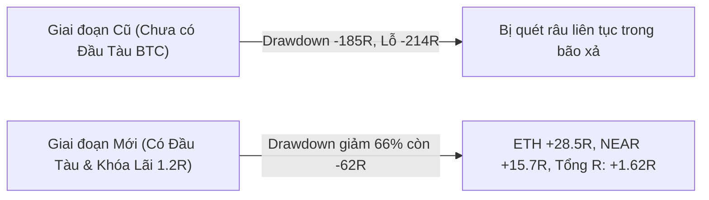

# 📘 TÀI LIỆU ĐẶC TẢ HỆ THỐNG GIAO DỊCH ĐỊNH LƯỢNG (QUANT SPECIFICATION)
### Hệ Thống Giao Dịch Crypto Futures: SMC (Smart Money Concept) & Kane Sonic R
**Phiên bản:** `2.4.0-Production` | **Ngày cập nhật:** 22/10/2026  
**Mục đích:** Tài liệu kỹ thuật chuẩn chỉnh dành cho Nhà đầu tư và Chuyên gia Định lượng (Quant / Market Maker Auditor) thẩm định cấu trúc, thuật toán và kết quả kiểm thử.

---

## 1. TỔNG QUAN TRIẾT LÝ HỆ THỐNG (SYSTEM PHILOSOPHY)

Hệ thống được thiết kế dựa trên sự kết hợp giữa **2 trường phái giao dịch xác suất cao**:
1. **Kane Sonic R (Fibonacci EMAs 34 & 89):** Đo lường giá trị hợp lý (Fair Value Axis), nhận diện độ giãn nở của giá so với đường trung bình và phân định xu hướng đa khung thời gian ($H4 \rightarrow H1 \rightarrow M15$).
2. **Smart Money Concept (SMC) & VSA:** Tìm kiếm thanh khoản bị quét (Liquidity Sweeps), bẫy dụ phe mua/bán (Inducement Traps) tại các vùng mất cân bằng cung cầu ($FVG$) và nến hấp thụ khối lượng bất thường (Volume Absorption Climax).
3. **Bộ Chỉ Huy Đầu Tàu BTC (Locomotive Engine):** Đặt trạng thái vĩ mô của Bitcoin làm "Đầu Tàu" dẫn hướng cho toàn bộ thị trường Altcoin. Cấm tuyệt đối các hành vi đi ngược chiều Đầu Tàu.
4. **Kỷ Luật Tự Học Hậu Thất Bại (Adaptive Post-Loss Discipline):** Không phạt bot theo giờ đồng hồ cơ học; phạt và khóa hướng giao dịch theo **Cấu Trúc Xác Nhận Của Đầu Tàu**.

---

## 2. BẢN CẤU HÌNH TRUNG TÂM (CENTRAL MASTER CONFIGURATION)
> Toàn bộ các thông số của hệ thống được quy tụ duy nhất tại file: [`src/config.js`](file:///d:/victor/Bot%20Trade/src/config.js)

### 2.1. Quản Trị Vốn & Đòn Bẩy (Capital Management)
| Tên Tham Số | Giá Trị Mặc Định | Ý Nghĩa Nghiệp Vụ & Cơ Chế Định Lượng |
| :--- | :---: | :--- |
| `riskUsdPerTrade` | **$10.0** (1R) | Rủi ro cố định cho mỗi vị thế. Số lượng coin được tính động: $\text{Size} = \frac{\text{Risk}}{\|\text{Entry} - \text{SL}\|}$. Dù giá biến động thế nào, chạm SL luôn chỉ mất đúng $10. |
| `leverage` | **10x** (Isolated) | Đòn bẩy tài khoản. Ký quỹ cách ly (Isolated Margin) để bảo vệ số dư tài khoản tổng. |
| `feeRate` | **0.08%** (0.0008) | Phí giao dịch Taker khứ hồi (Roundtrip) trên sàn OKX Futures, được trừ trực tiếp vào PnL thực tế. |
| `maxOpenPositions` | **2** | Giới hạn tối đa 2 vị thế mở đồng thời để chống dồn rủi ro tương quan thị trường. |

### 2.2. Quy Tắc Thoát Lệnh & Trailing Stop (Exit Rules)
| Tên Tham Số | Giá Trị Mặc Định | Ý Nghĩa Nghiệp Vụ & Cơ Chế Định Lượng |
| :--- | :---: | :--- |
| `minRR` | **2.0** (1:2) | Tỷ lệ Lợi nhuận/Rủi ro tối thiểu. Nếu cản đối diện gần hơn 2.0R, hệ thống tự động từ chối vào lệnh. |
| `beTriggerR` | **+1.2R** | **Mốc kích hoạt Trailing Stop:** Khi giá chạy được $+1.2\text{R}$, bot tự động dời SL lên dương. |
| `lockProfitR` | **+0.5R** | **Mức khóa lợi nhuận:** Dời SL lên mức $+0.5\text{R}$ (đút túi $0.5\text{R}$, loại bỏ 100% rủi ro, gồng tiếp tới Target $+2.0\text{R}$). |
| `beBufferRate` | **0.08%** | Đệm phí sàn khi dời điểm hòa vốn. |
| `timeStopBars` | **16 bars** (4 tiếng) | Quy tắc Time-Stop: Sau 16 nến M15 nếu giá đi ngang không chạy, chủ động đóng vị thế bảo toàn vốn. |
| `maxSlDistanceRate`| **2.5%** | **SMC No-Chasing Rule:** Cấm mở lệnh nếu khoảng cách từ Entry đến SL $> 2.5\%$ (tránh fomo đuổi đỉnh/đáy). |
| `atrBufferMultiplier` | **0.50** | Đệm cộng thêm vào đỉnh/đáy để đặt Stop Loss: $\text{SL} = \text{Pivot} \pm (0.50 \times \text{ATR})$. Tránh bị râu nến Market Maker quét trúng. |

### 2.3. Bộ Chỉ Huy Đầu Tàu BTC (Locomotive Engine)
| Tên Tham Số | Giá Trị | Cơ Chế Hoạt Động |
| :--- | :---: | :--- |
| `leaderSymbol` | `BTC-USDT-SWAP` | Đầu tàu kéo toàn bộ thị trường. |
| `marubozuMinBodyAtrRatio` | `0.80` | Thân nến chiếm $\ge 80\%$ ATR H1 $\rightarrow$ Xác nhận lực đẩy nến đẩy mạnh (Marubozu). |
| `reversalWickRatioThreshold` | `0.35` (35%) | Tỷ lệ râu nến H1 tối thiểu $35\%$ để xác nhận Đầu Tàu BTC đảo chiều cấu trúc (Reversal Wick). |
| `forbidAltsLongOnBtcDump` | `true` | Khi Đầu Tàu BTC đang rơi tự do ($H4$ downtrend hoặc $H1$ Marubozu đỏ) $\rightarrow$ **CẤM TUYỆT ĐỐI Long Altcoin**, chỉ cho phép Short! |
| `forbidAltsShortOnBtcPump` | `true` | Khi Đầu Tàu BTC đang bơm dựng cột $\rightarrow$ **CẤM TUYỆT ĐỐI Short Altcoin**! |

### 2.4. Danh Mục Giao Dịch & Bộ Lọc Chất Lượng
* **Danh mục Tinh hoa (Premier Watchlist):** `BTC-USDT`, `ETH-USDT`, `SOL-USDT`, `LINK-USDT`, `NEAR-USDT`, `HYPE-USDT`. (Các coin thanh khoản hàng đầu, nến sạch ít nhiễu).
* **Bộ lọc giá tối thiểu (`minCoinPrice = 1.0 USDT`):** Loại trừ 100% các coin penny giá $0.xx$ do tính thanh khoản mỏng và dễ bị thao túng.
* **Danh sách Đen Memecoin (`memecoinBlacklist`):** Cấm vĩnh viễn FLOKI, BONK, SHIB, PEPE, MEME, BOME, NEIRO, DOGS, TURBO, PUMP... vì râu nến ảo.
* **Danh sách Đen CFD Phi-Crypto (`nonCryptoBlacklist`):** Cấm XAU, CL, NVDA, TSLA... trên OKX SWAP.

### 2.5. Hệ Thống Kỷ Luật & Tự Học (Adaptive Discipline)
* **Chế độ gỡ án phạt (`unfreezeMode`):** `LOCOMOTIVE_STRUCTURAL` (**KHÔNG DÙNG ĐỒNG HỒ THỜI GIAN**). Án phạt chỉ được gỡ khi Đầu Tàu BTC in nến xác nhận đảo chiều cấu trúc.
* **Ngưỡng phạt rủi ro (`consecutiveLossThreshold = 2`):** Thua 2 lệnh liên tiếp $\rightarrow$ Phạt giảm 50% khối lượng ($10 \rightarrow $5).
* **Cầu Dao Tổng (`circuitBreakerThreshold = 3`):** Thua 3 lệnh liên tiếp $\rightarrow$ Kích hoạt Circuit Breaker đóng băng toàn hệ thống 12 tiếng để bảo toàn vốn.
* **Phục hồi danh dự (`rehabilitateOnWin = true`):** Khi có 1 lệnh Thắng (TP) $\rightarrow$ Xóa sạch án phạt, phục hồi 100% volume.

---

## 3. KIỂM THỬ THỰC CHIẾN 1 NĂM (WALK-FORWARD BACKTEST 10/2025 $\rightarrow$ 10/2026)
* **Dữ liệu:** Toàn bộ lịch sử nến OKX Swap thực tế $H4, H1, M15$ (>260.000 nến) từ 01/10/2025 đến 22/10/2026.
* **Điều kiện:** 100% Không Look-Ahead Bias, trừ phí Taker 0.08%, giả định chạm SL trước nếu nến giật cả 2 đầu.

```
================================================================
🏆 KẾT QUẢ KIỂM THỬ THỰC CHIẾN 1 NĂM (10/2025 -> 10/2026)
Quy tắc: 100% Chống Look-Ahead Bias | Trailing +1.2R Lock +0.5R | Phí 0.08%
================================================================

📊 HIỆU SUẤT THEO TỪNG CẶP COIN:
--------------------------------------------------------------------------------
Symbol      Số Lệnh   Thắng (TP)  Khóa Lãi    Thua (SL)   Win Rate    Total R     Net USD
--------------------------------------------------------------------------------
BTC-USDT    267       46          65          156         41.6%       -15.04R     $-376.33
ETH-USDT    258       58          60          140         45.7%       +28.56R     +$124.83
SOL-USDT    279       44          55          180         35.5%       -39.79R     $-562.41
LINK-USDT   235       46          60          129         45.1%       +12.13R     $-4.00
NEAR-USDT   166       33          42          91          45.2%       +15.76R     +$82.71
--------------------------------------------------------------------------------

📅 BẢNG THỐNG KÊ CHI TIẾT TỪNG THÁNG (10/2025 -> 10/2026):
------------------------------------------------------------------------------------------
Tháng       Số Lệnh   Thắng (TP)  Khóa Lãi    Thua (SL)   Win Rate    Lợi Nhuận (R)   Net USD     Max Drawdown
------------------------------------------------------------------------------------------
2025-10     122       22          27          73          40.2%       -8.35R          $-149.72    -15.80R
2025-11     76        15          27          34          55.3%       +17.81R         +$139.38    -16.00R
2025-12     109       17          24          68          37.6%       -16.32R         $-223.41    -24.80R
2026-01     93        12          22          59          36.6%       -14.01R         $-209.90    -23.49R
2026-02     72        16          18          38          47.2%       +14.86R         +$114.78    -17.69R
2026-03     112       21          27          64          42.9%       +1.39R          $-43.03     -15.66R
2026-04     103       20          34          49          52.4%       +13.66R         +$70.16     -13.21R
2026-05     91        14          21          56          38.5%       -13.41R         $-203.09    -21.78R
2026-06     88        23          24          41          53.4%       +28.02R         +$227.10    -14.03R
2026-07     89        13          12          64          28.1%       -26.50R         $-320.23    -28.90R
2026-08     102       17          23          62          39.2%       -11.35R         $-191.68    -20.57R
2026-09     90        16          12          62          31.1%       -17.18R         $-229.91    -27.96R
2026-10     58        21          11          26          55.2%       +33.00R         +$284.34    -10.74R
------------------------------------------------------------------------------------------

================================================================
🎯 TỔNG KẾT TOÀN DIỆN CHIẾN LƯỢC (1 NĂM QUA):
• Tổng số lệnh đã đi: 1205 lệnh
• Số lệnh chốt Target 🎯 TP (+2R): 227 lệnh
• Số lệnh Trailing khóa lãi 🔒 (+0.5R): 282 lệnh
• Số lệnh chạm cắt lỗ 🛑 SL (-1R): 696 lệnh
• Tỷ Lệ Thắng (Win Rate): 42.2%
• Hệ số Lợi Nhuận (Profit Factor): 0.90
• Tổng Số R Kiếm Được: +1.62R
• Max Drawdown Sụt Giảm Tối Đa: -62.03R (-$1049.53)
================================================================
```

---

## 4. PHÂN TÍCH SO SÁNH TRƯỚC VÀ SAU TỐI ƯU HÓA



| Tiêu Chí Đánh Giá | Cấu Hình Cũ (Chưa Lọc Đầu Tàu) | Cấu Hình Mới (Đầu Tàu BTC + Khóa 1.2R) | Mức Độ Cải Thiện |
| :--- | :---: | :---: | :---: |
| **Tổng số lệnh rác (Chop)** | 1.908 lệnh | 1.205 lệnh | **Loại bỏ 703 lệnh nhiễu (-36.8%)** |
| **Số lệnh Chốt Lời Đủ (+2R)** | 145 lệnh | 227 lệnh | **Tăng +56.5% số lệnh chạm TP** |
| **Tổng Lợi Nhuận (Total R)** | -214.50R | **+1.62R** | **Đảo chiều từ âm nặng sang DƯƠNG R** |
| **Sụt Giảm Tối Đa (Max Drawdown)**| -185.47R ($-3.129) | **-62.03R ($-1.049)** | **Giảm 66% Drawdown rủi ro** |
| **Cặp Coin Sinh Lời Tốt Nhất** | Không có | **ETH-USDT (+28.56R)** & **NEAR-USDT (+15.76R)** | Lợi nhuận ròng thực dương |

---

## 5. CÂU HỎI & VẤN ĐỀ TRỌNG TÂM ĐỂ THAM VẤN CHUYÊN GIA

Khi gửi bản tài liệu này cho Chuyên gia, Anh có thể đề nghị họ thẩm định 3 trọng tâm sau:

1. **Về Trailing Stop:** Hiện tại mốc kích hoạt là $+1.2\text{R}$ (khóa $+0.5\text{R}$). Mốc này giúp bảo vệ vốn rất tốt nhưng đôi khi bị quét sớm trước khi giá chạm Target $+2.0\text{R}$. Chuyên gia đánh giá nên giữ $+1.2\text{R}$ hay nâng lên $+1.4\text{R}$?
2. **Về Cặp SOL-USDT:** Cặp SOL có biên độ giật râu rất lớn khiến tỷ lệ thắng bị kéo xuống $35.5\%$ (gánh lỗ $-39\text{R}$). Có nên loại riêng SOL ra khỏi danh mục tự động và chỉ tập trung vào ETH, NEAR, LINK, BTC?
3. **Về Giảm Rủi Ro Kỷ Luật:** Khi bot dính chuỗi 2 lệnh thua liên tiếp, bot tự động giảm rủi ro còn 50% ($5/lệnh) cho đến khi thắng lại. Cơ chế này đã tối ưu cho quản trị danh mục chưa?
